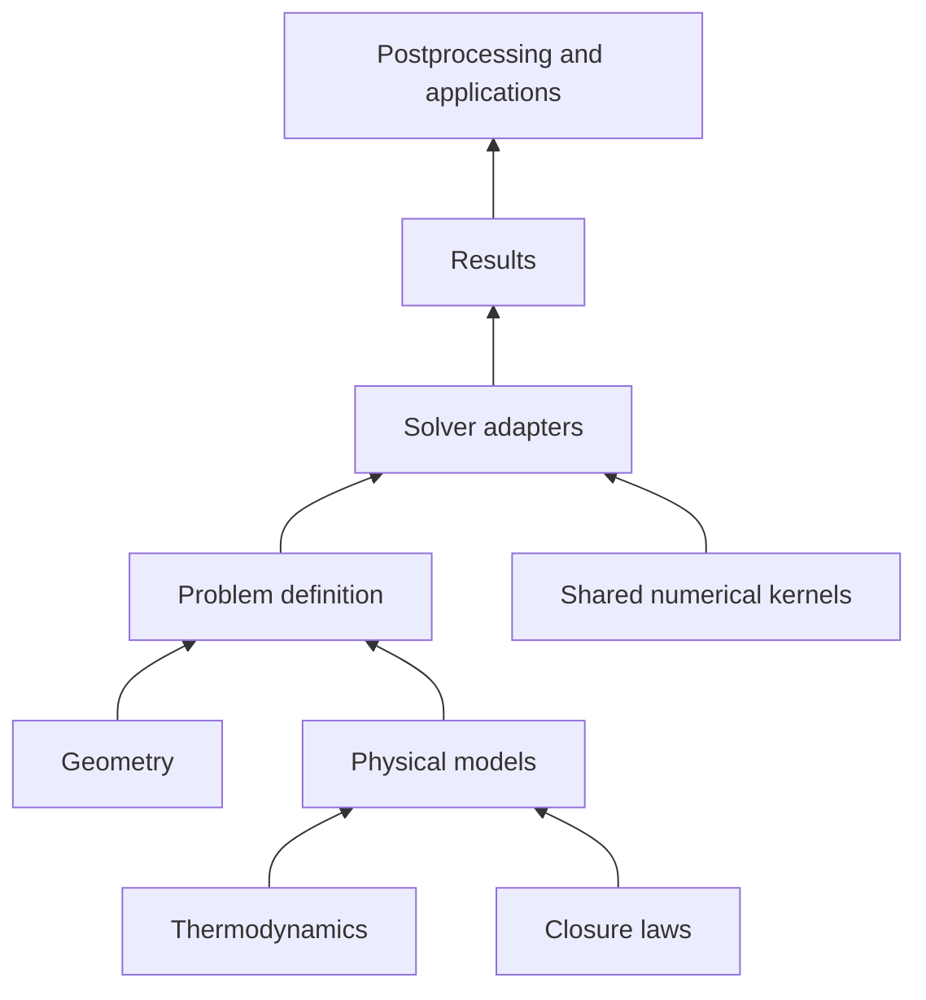

# Refactoring nozzle-hyperbolic and integrating it into NozzleX

Date: 2026-10-16. This is an architecture proposal based on the local source trees, including local modifications present during review. No solver implementation has been changed or executed for this note.

## Recommendation

**Yes: merge into one repository, with one installable `nozzlex` package. Organize the physics by equation model and the numerical methods by solution strategy.** A nozzle or annular-channel problem should exist independently of whether it is solved by spatial integration, collocation, or finite-volume time marching.

The strongest reason is scientific consistency: geometry, thermodynamic states, wall forces, heat transfer, and interphase closures should have one authoritative implementation. Then the steady limit of a time-marching calculation can be compared meaningfully with a spatial solution. The repositories already use almost the same numerical stack and Python version range in their `pyproject.toml` files.

The merger should be incremental. Copying the current packages into one repository is a useful migration step, but it does not itself create shared physics. Avoid making permanent top-level `hyperbolic/` and `space_marching/` packages that each own their own nozzle equations and closures.

For the three requested problem families, use:

1. `Quasi1DEuler`: a single-velocity, general-EOS nozzle model. A perfect gas is a fluid implementation, not a separate equation model.
2. `TwoFluid`: the common-pressure, separate-velocity, separate-energy model currently implemented in the hyperbolic repository, with explicit closure choices.
3. `AnnularChannel`: the four-equation single-fluid model with meridional velocity and swirl, based on the unsteady equations in `docs/`.

Retain existing homogeneous nonequilibrium and relaxation models in NozzleX as distinct models during migration. They are not interchangeable with the separate-velocity two-fluid equations.

## What the source currently contains

Paths in this section are relative to the workspace containing both repositories. They identify the inspected implementation rather than relying on directory names or README descriptions.

| Source | Observation and architectural implication |
|---|---|
| `nozzle-hyperbolic/nozzle_hyperbolic/fvm_solver/fvm.py` | Roughly 2,900 lines combining initialization, EOS inversions, physical fluxes, reconstruction, boundary conditions, correlations, explicit steps, implicit steps, Jacobians, linear solves, and the run driver. This is the main extraction target. |
| `.../fvm_solver/flux.py` | Parallel perfect-gas/general-EOS flux implementations, with additional JAX flux implementations in `fvm.py`. Consolidate by numerical method and EOS contract after checking numerical equivalence. |
| `.../fvm_solver/two_fluid/{state,matrices,flux,sources,solver}.py` | A useful initial separation already exists. However, `solver.py` is roughly 2,500 lines and mixes physical boundaries, reconstruction, stabilization, EOS projection, residual assembly, and Newton machinery. Preserve its algorithms while extracting ownership. |
| `.../two_fluid/matrices.py`, `.../two_fluid/solver.py` | Six physical primitive variables `(p, u_g, u_l, alpha_g, h_g, h_l)` coexist with six balance variables and eight Newton variables. A common framework must not assume the Newton vector has the same size as the physical state or balance vector. |
| `.../two_fluid/sources.py`, `.../source_two_fluid.py` | Closure evaluation and equation-specific source assembly are partly separated already. The `sys.path.insert` import workaround should become a package-relative import. |
| `.../fvm_solver/geometry.py` | Geometry is currently returned as sampled arrays, including `A`, `dAdx`, and `D_h`. Spatial solvers instead need continuous geometry evaluations. Separate geometry definitions from mesh sampling. |
| `nozzlex/nozzlex/functions/nozzle_model_{core,solver}.py` | General-EOS nozzle physics, determinant-based autonomous spatial integration, critical-inlet searches, and Chebyshev collocation utilities. NozzleX already includes more than just a straightforward space march. |
| `nozzlex/nozzlex/two_fluid/nozzle_model_{core,solver}.py` | The inspected implementation exposes `nozzle_single_phase_*` equations and solvers with a single velocity. Do not interpret this directory as an existing spatial counterpart of the hyperbolic six-equation two-fluid model. |
| `nozzlex/nozzlex/homogeneous_nonequilibrium/nozzle_model_core.py` | Uses two phase enthalpies and a common velocity, with interphase heat exchange. This is a different physical model from the separate-velocity hyperbolic model, despite shared thermodynamic and correlation needs. |
| `nozzlex/nozzlex/vaneless_channel/vaneless_channel_model.py` | Already implements steady annular-channel flow, NURBS-based geometry, ODE integration, derived quantities, plotting, and configuration classes. Reuse its physics and geometry after reconciliation with the unsteady specification. |
| `.../vaneless_channel/{friction_models,heat_models}.py` | Existing Equinox closure objects provide a useful starting point; annular secondary-loss models should remain specialized. |
| Both package `__init__.py` files | Broad imports and process-wide behavior are mixed with public exports. NozzleX forces the CPU backend and enables x64 at import. Move runtime choices to applications or explicit setup, and keep package imports lightweight. |
| `nozzle-hyperbolic/tests/` | Existing FVS and metastability tests contain valuable numerical contracts. Some closure discrepancies are deliberately recorded as strict expected failures; preserve this distinction during migration. |

The annular design sources are `nozzle-hyperbolic/docs/Unsteady 1D Annular Diffuser Equations.md`, `docs/vaneless_diffuser_model.md`, and `docs/Vaneless space model.md`. These are design inputs, not proof that a time-dependent annular solver already exists.

## Standalone nozzle-hyperbolic structure

Use a `src` layout now so the same internal organization can later move under `src/nozzlex/`. The repository name may remain `nozzle-hyperbolic`; its Python import name remains `nozzle_hyperbolic` until migration.

```text
nozzle-hyperbolic/
├── pyproject.toml
├── src/
│   └── nozzle_hyperbolic/
│       ├── __init__.py                 # deliberate public exports
│       ├── problem.py                  # model + fluid + geometry + closures
│       ├── results.py                  # states, coordinates, diagnostics, status
│       ├── thermodynamics/
│       │   ├── interface.py            # property contracts and capabilities
│       │   ├── jaxprop.py              # thin adapters, no new EOS library
│       │   └── recovery.py             # state inversion and validity status
│       ├── geometry/
│       │   ├── duct.py                 # continuous A, dA/ds, perimeter, D_h
│       │   ├── annular.py              # radius, height, inclination, curvature
│       │   ├── profiles.py             # analytic and spline definitions
│       │   └── sampling.py             # values at cells, faces; cell volumes
│       ├── closures/
│       │   ├── wall_friction.py
│       │   ├── wall_heat.py
│       │   ├── annular_losses.py
│       │   └── interphase/
│       │       ├── drag.py
│       │       ├── heat.py
│       │       ├── mass_transfer.py
│       │       └── area.py
│       ├── models/
│       │   ├── quasi1d_euler/
│       │   │   ├── model.py
│       │   │   ├── state.py
│       │   │   ├── equations.py         # storage, physical flux, sources
│       │   │   └── characteristics.py
│       │   ├── two_fluid/
│       │   │   ├── model.py
│       │   │   ├── state.py
│       │   │   ├── equations.py
│       │   │   ├── matrices.py
│       │   │   └── characteristics.py
│       │   └── annular_channel/
│       │       ├── model.py
│       │       ├── state.py
│       │       ├── equations.py
│       │       └── characteristics.py
│       ├── boundaries/
│       │   ├── specifications.py        # reservoir, pressure, prescribed state
│       │   ├── euler.py                 # characteristic compatibility
│       │   ├── two_fluid.py
│       │   └── annular.py
│       ├── numerics/
│       │   ├── mesh.py
│       │   ├── reconstruction.py        # array operations, limiters
│       │   ├── fluxes/
│       │   │   ├── hll.py               # reusable algebra and wave bounds
│       │   │   ├── rusanov.py
│       │   │   ├── euler_fvs.py
│       │   │   └── two_fluid_fvs.py      # specialized nonconservative treatment
│       │   ├── nonlinear.py            # Newton loop and convergence reporting
│       │   ├── linear.py               # dense/banded/block linear solves
│       │   └── jacobians.py             # dense AD, coloring, stencil metadata
│       ├── solvers/
│       │   ├── finite_volume/
│       │   │   ├── operator.py          # conservative flux/source assembly
│       │   │   ├── two_fluid.py         # specialized residual and EOS constraints
│       │   │   └── stabilization.py
│       │   ├── time_marching/
│       │   │   ├── explicit.py
│       │   │   ├── implicit.py
│       │   │   └── control.py          # physical-time versus steady convergence
│       │   └── initialization.py
│       ├── io/
│       │   ├── config.py               # parse/validate before JIT
│       │   └── output.py
│       ├── postprocessing/
│       │   ├── quantities.py
│       │   └── plotting.py
│       └── reference/                  # analytic/semi-analytic benchmarks
├── tests/
│   ├── unit/
│   ├── regression/
│   └── verification/
├── examples/
├── validation_cases/                   # experiments and comparison scripts
├── case_study/                         # research runs and case-specific analysis
├── case_roberto/                       # these design notes
└── docs/
```

This is a target ownership map, not a requirement to create every file immediately. Start with small modules containing useful code; split further when responsibilities actually diverge. Update Poetry package discovery for `src` and verify installed-package imports outside the repository directory.

### Dependency direction and reuse



Physics must not import a time stepper, Diffrax, plotting, YAML loaders, or a run script. Closures return physical quantities; model-specific code places them into the correct equations. Solvers consume model operations and numerical utilities. Shared numerical kernels should not depend on particular thermodynamic fluids.

| Share across models and solvers | Keep model- or method-specific |
|---|---|
| Thermodynamic adapters, property naming, phase-property evaluation | State ordering, balance-variable maps, and EOS constraints |
| Continuous geometry and its consistent sampling | Annular curvature/swirl forces and two-fluid nonconservative terms |
| Wall and interphase correlation laws where assumptions match | How those forces and exchanges enter each equation |
| Limiters and reconstruction arithmetic | Reconstruction variable choices and admissibility checks |
| HLL/Rusanov algebra for compatible conservative systems | Euler/two-fluid FVS, general-EOS Roe averaging, HLLC star states |
| Newton iteration, scaling hooks, linear algebra, Jacobian coloring | Residual definition, projection, stencil width, boundary dependence |
| Output schema, logging, configuration handling | Transient initial data and spatial IVP/shooting data |

Do not introduce a large `utils.py` or a base solver with dozens of flags. Extract a shared operation only after its callers have the same mathematical contract. Keep ghost-phase filters and other research stabilizations named and configurable; do not silently enable them for every model.

## Physical and numerical contracts

### General-EOS formulation, including a perfect gas

The main nozzle equations must not branch on `perfect_gas=True`. Obtain density, pressure, enthalpy/internal energy, sound speed, and required derivatives through the fluid interface. Prefer existing `jaxprop` perfect-gas and general-fluid implementations, with thin local adapters for conventions and supported input pairs.

Use capability-specific requirements. A `(p,h)` primitive formulation requires `state_ph(p,h)` and derivatives such as `(drho/dp)_h` and `(drho/dh)_p`; a conservative formulation requires reliable `(rho,e)` recovery. Reservoir boundaries may require `(h,s)` or `(p,s)` calls. A thermodynamic backend need not support every pair natively: an adapter can provide recovery, but must report failure and domain violations.

Compute related properties from the same EOS state. The existing `phase_props()` identity-based derivative calculation is a useful starting point. Do not independently interpolate incompatible sound speeds and derivatives. Cache property bundles within a residual evaluation rather than repeatedly querying the same state.

Allow specialized perfect-gas formulas as reference solutions or measured optimizations behind the same contract. The general-EOS path must pass the perfect-gas benchmarks on its own. Remove duplicate production formulas only after comparison.

Move table inversions, clipping policies, and fallback behavior out of flux/solver modules. A failed root search should produce a diagnostic or rejected step; a midpoint fallback should not silently become a valid physical state.

### Separate three representations of state

Give each model explicit operations for physical primitives, balance storage, and solver unknowns. Names should state the representation; currently `U_h` means primitive variables in the two-fluid implementation, whereas `V` means balance variables.

| Model | Suggested physical primitives | Balance storage per unit volume |
|---|---|---|
| Quasi-1D Euler | `(p, u, h)` | `(rho, rho*u, rho*E)` |
| Two-fluid | `(p, u_g, u_l, alpha_g, h_g, h_l)` | Two partial densities, two momenta, two total energies, with nonconservative coupling |
| Annular channel | `(p, v_m, v_theta, h)` | `(rho, rho*v_m, rho*v_theta, rho*E)` |

Keep the existing eight-variable two-fluid Newton representation in its solver adapter. Its EOS rows, projection, rectangular least-squares variants, and scaling are numerical choices; they should not define the public physical state.

A small model contract can expose `storage(primitive, thermo)`, `physical_flux(...)`, `physical_sources(...)`, `characteristic_speeds(...)`, and state validity. Add `steady_system(...) -> (M,b)` for spatially supported models. Use a separate capability for nonconservative coupling; a generic conservative `flux()` interface is insufficient for the two-fluid scheme.

### Geometry weighting and finite volumes

Adopt one convention internally: store unweighted balance densities `q`, evaluate physical flux `f`, and let the finite-volume operator own face areas and cell volumes. For a static duct,

```text
V_i * d(q_i)/dt = -(A_right*fhat_right - A_left*fhat_left) + integrated_source_i
V_i = integral_cell A(s) ds
```

The annular document's `U=A*q` is compatible with this convention for fixed geometry. Conversion must be explicit; never multiply an already area-weighted flux by area again. Approximate `V_i` consistently and document quadrature. Keep pressure-area source quadrature paired with face geometry, including tests of a stationary constant-pressure state in a variable-area duct.

Geometry should be a continuous callable returning named quantities. A sampler produces cell/face arrays and metrics for finite volumes; spatial integrators call the same definition at arbitrary coordinates. Start with uniform meshes if needed, but avoid hiding uniform spacing assumptions inside geometry or physics.

Use SI units and radians internally. Convert existing degree-based configurations at their input boundary. Do not confuse the annular mean radius with nozzle hydraulic radius: annular geometry additionally requires `r`, `b`, `dr/dm`, inclination, and curvature. Retain the documented thin-channel assumptions when using `A=2*pi*r*b` and `D_h=2*b`.

### JAX and numerical infrastructure

Use pure JAX kernels with immutable PyTrees/Equinox parameter objects; assemble and validate configuration outside JIT. Choose methods and static branches when constructing the solver. Keep file access, CoolProp table generation, figures, and progress reporting outside compiled functions.

Extract Newton and linear-algebra infrastructure through callbacks for residuals, scales, admissibility, and constraints. Do not force the two-fluid rectangular system into a square Euler solver. Jacobian coloring must receive actual stencil metadata: MUSCL and the existing background filters can require wider bands than first-order reconstruction. Preserve dense-versus-colored comparisons on small systems and account for boundary dependencies.

Treat differentiability as an explicit capability. Sharing JAX code does not guarantee reliable derivatives through clipping, phase transitions, nonlinear failures, shock motion, or steady-state convergence.

## Annular-channel model as a first-class feature

Implement the four physical balances from the unsteady document in the annular model, rather than adding an optional fourth component to every existing Euler routine. With `E=e+(v_m**2+v_theta**2)/2` and `H=E+p/rho`, the unweighted quantities are:

```text
q = [rho, rho*v_m, rho*v_theta, rho*E]
f = [rho*v_m, rho*v_m**2+p, rho*v_m*v_theta, rho*v_m*H]

S_integrated_per_unit_m = [
    0,
    p*dA/dm + A*rho*v_theta**2/r*dr/dm - 2*A*tau_m/b,
    -A*rho*v_m*v_theta/r*dr/dm - 2*A*tau_theta/b,
    2*A*q_wall/b,
]
```

Here `tau_m` and `tau_theta` are signed resisting stress components; positive `q_wall` heats the fluid. A simple isotropic wall law projects one shear magnitude onto the velocity direction. The existing NozzleX Aungier model additionally places diffusion and curvature losses in meridional stress only. Preserve that as a distinct closure choice, rather than equating it with the simpler document model.

For stationary walls the total-energy source contains heat, without adding a separate wall-friction energy sink: friction changes kinetic/internal energy and entropy while conserving total energy in the adiabatic model. In the inviscid adiabatic steady case, check mass flow, stagnation enthalpy, and `r*v_theta`.

The documented local characteristic speeds are `v_m-a`, `v_m`, `v_m`, `v_m+a`, for admissible states with positive sound-speed squared. Reuse reconstruction, conservative HLL/Rusanov kernels, temporal integration, and nonlinear infrastructure. Supply annular-specific state recovery, characteristic boundaries, and sources. Add FVS or HLLC only with the correct four-equation/general-EOS derivation.

For positive meridional flow, the document's boundary counts are three incoming conditions at a subsonic inlet and one at a subsonic outlet; a supersonic inlet requires four and a supersonic outlet zero. Encode these through model-specific boundary adapters. Handle sonic transitions and flow reversal explicitly rather than assuming the forward-flow counts always apply.

### Reconcile these details before declaring steady/unsteady equivalence

These are source-review findings to verify during implementation, not fixes made by this proposal:

- In `evaluate_vaneless_channel_ode()`, the implemented continuity row has an enthalpy coefficient `-G/a**2`, whereas the documented density derivative and the other nozzle implementation give `-rho*G/a**2`. Check the intended variable scaling and correct the verified equation.
- The implemented annular energy row is `dh/dm + v_m*dv_m/dm + v_theta*dv_theta/dm = (2/b)*q_w`. The heat model returns `q_w` in W/m². With that definition the right side should be `2*q_w/(rho*v_m*b)`. Reconcile this normalization in code and notes before comparing heated cases; adiabatic cases alone cannot reveal it.
- Annular code converts `alpha_in` and `phi` using `deg2rad`, while some docstrings say radians. Make units explicit in compatibility adapters.
- Preserve the difference between Darcy friction factors and skin/Fanning coefficients: with the definitions used here, `f_D=4*C_f`. Convert to physical stresses at a single documented boundary.
- The unsteady note says the explicit acoustic time step collapses as `v_m-a` approaches zero. The code's explicit CFL estimate instead uses `abs(v_m)+a`, which remains finite at sonic flow. Separate steady spatial singularity from explicit stability restrictions.
- Backward Euler's linear stability properties do not guarantee nonlinear convergence, valid EOS states, accurate transients, or arbitrary usable step sizes. Likewise, retaining hyperbolicity does not by itself prove well-posedness for an arbitrary boundary specification.

Adiabatic steady reduction, heated steady reduction, and boundary compatibility should be explicit acceptance checks for the new annular implementation. Start with the simple wall law, then add the existing empirical losses and compare each closure separately.

## Structure of the merged NozzleX repository

Preserve the shared directories above, replace their package root with `nozzlex`, and extend the model and solver sets:

```text
nozzlex/
├── pyproject.toml                      # one distribution and dependency policy
├── src/nozzlex/
│   ├── __init__.py
│   ├── problem.py
│   ├── results.py
│   ├── thermodynamics/                # shared
│   ├── geometry/                      # shared
│   ├── closures/                      # shared
│   ├── models/
│   │   ├── quasi1d_euler/
│   │   ├── two_fluid/
│   │   ├── annular_channel/
│   │   ├── homogeneous_nonequilibrium/
│   │   └── homogeneous_relaxation/
│   ├── boundaries/
│   ├── numerics/
│   │   ├── reconstruction.py
│   │   ├── fluxes/
│   │   ├── nonlinear.py
│   │   ├── linear.py
│   │   ├── jacobians.py
│   │   └── interpolation.py           # e.g. shared collocation utilities
│   ├── solvers/
│   │   ├── finite_volume/
│   │   ├── time_marching/
│   │   ├── space_marching/
│   │   │   ├── ivp.py
│   │   │   ├── autonomous.py          # spatial reparameterization, not time
│   │   │   ├── shooting.py
│   │   │   └── critical.py
│   │   └── collocation/
│   ├── reference/
│   ├── design/                        # existing inverse_design functionality
│   ├── postprocessing/
│   └── io/
├── tests/
├── examples/{nozzle,two_fluid,annular_channel,inverse_design}/
├── validation_cases/
├── case_study/
└── docs/{models,numerics,api,migration}/
```

An equilibrium mixture that satisfies the same three balances can use `Quasi1DEuler` with an equilibrium thermodynamic closure, subject to validity and sound-speed requirements. Relaxation models with additional transported variables remain separate. Keep legacy CoolProp-based property wrappers available temporarily; replace them only after checking their phase and derivative semantics.

Keep inverse design as a consumer of the common forward problems, geometry, and solver API. Keep plotting optional and move profiling, bibliography, and documentation tools to appropriate development dependency groups. Reuse the existing JAX/Equinox/Diffrax ecosystem rather than introducing another framework for the merger.

One repository can temporarily contain both import namespaces to preserve working cases and history. The target remains one implementation of shared functionality. A permanent multi-package monorepo is justified only if independent release schedules or dependency constraints become concrete requirements; the current manifests do not establish such a need.

## Calling time or space solvers for the same problem

Yes, this is a good public API goal. A problem definition should be reusable, but each method needs appropriate mathematical data. A fully specified inlet state for a spatial IVP is not automatically the same boundary-value problem as reservoir/back-pressure conditions for time marching.

Proposed API sketch, not existing callable code:

```python
problem = FlowProblem(
    model=Quasi1DEuler(),
    fluid=fluid,
    geometry=geometry,
    closures=closures,
)

spatial = solve_steady(
    problem,
    method=SpaceMarching(options=space_options),
    data=SpatialIVP(inlet_state=inlet_state),
)

steady_fvm = solve_steady(
    problem,
    method=TimeMarching(mesh=mesh, options=steady_time_options),
    data=BoundaryValueData(inlet=reservoir, outlet=back_pressure),
    initial=initial_field,
)

transient = solve_transient(
    problem,
    method=TimeMarching(mesh=mesh, options=physical_time_options),
    data=time_dependent_boundaries,
    initial=initial_field,
    times=save_times,
)
```

Swap the model for `AnnularChannel()` with annular geometry and suitable inlet swirl. The eventual `TwoFluid()` spatial adapter must be implemented for that actual equation set before it is offered through this API. Unsupported combinations should fail at construction with a useful explanation.

| Model | Finite-volume time marching | Spatial methods |
|---|---|---|
| General-EOS nozzle | Existing explicit/implicit implementations to migrate | Existing spatial/autonomous and collocation code to reconcile |
| Separate-velocity two-fluid | Existing specialized implicit implementation | New implementation needed for the same equations; current `two_fluid/` naming is insufficient |
| Annular channel | Planned new implementation | Existing steady implementation, with the consistency checks above |
| Homogeneous nonequilibrium / relaxation | Additional implementation if required | Preserve current implementations as separate capabilities |

Space marching is efficient for smooth steady branches with adequate inlet data. Shooting or collocation can enforce additional boundary conditions; critical-point handling remains necessary near choking. The autonomous coordinate `tau` in NozzleX is a spatial reparameterization, not physical or pseudo-time integration of the unsteady balances.

Time marching supports transients and can approach steady solutions with shocks and downstream influence, given valid models and boundaries. Steady acceleration may use local pseudo-time steps or other convergence devices; those do not define a physical time history. `solve_transient` must use consistent physical time, suitable tolerances, and temporal-convergence checks.

The two methods should agree on smooth steady solutions only when geometry, EOS, closure parameters, boundary conditions, branch, and phase assumptions match. Compare under mesh/tolerance refinement. For shocks, do not expect a smooth spatial IVP to reproduce a captured discontinuity without shock fitting and jump conditions. Do not promise universal steady convergence or automatic switching at choking.

Use a shared result vocabulary for primitive and derived fields, units, coordinate, model/closure metadata, convergence status, and conservation errors. A transient result also has physical time; a steady result may report iteration history separately. Derive thermodynamic and performance quantities through common postprocessing, while keeping cumulative spatial loss integrals separate from transported physical states.

## Concrete extraction map

| Current implementation | Destination / action |
|---|---|
| `fvm.py`: `_get_state_ps`, `_get_state_hs`, `_state_rho_u`, batch recovery | `thermodynamics/recovery.py`, with explicit validity and failure reporting |
| `fvm.py`: limiters and MUSCL | `numerics/reconstruction.py`; retain model-specific variable conversion in adapters |
| `flux.py` and `fvm.py`: repeated Euler fluxes | Shared physical Euler flux in the model; one tested implementation per numerical flux method |
| `fvm.py`: `_residual`, `make_jax_stadtke_step`, `make_jax_step` | Finite-volume assembly plus separate time integration; retain primitive Newton variables where useful |
| Both implicit solvers: coloring, band assembly, Newton solves | Shared numerical kernels with explicit dimensions, bandwidth, and constraints |
| `two_fluid/state.py`, `matrices.py` | `models/two_fluid/`; move only EOS bundle evaluation to thermodynamics |
| `two_fluid/flux.py` | `numerics/fluxes/two_fluid_fvs.py` plus specialized finite-volume coupling |
| `source_two_fluid.py`, `two_fluid/sources.py` | Correlations to `closures/interphase/`; physical source assembly to `models/two_fluid/equations.py` |
| `geometry.py`, geometry functions in NozzleX cores | Continuous definitions in `geometry/`; explicit adapters for existing tuple/array formats |
| NozzleX nozzle core | `models/quasi1d_euler/`; move correlations, geometry, and output assembly out |
| NozzleX nozzle solvers | Spatial, shooting/critical, and collocation adapters; extract interpolation independently |
| `vaneless_channel_model.py` | Split into annular physics, annular geometry, spatial solve, configuration, and plotting |
| `dev_scripts/main_two_fluid.py` and configuration/initialization helpers | Promote reusable run control and initialization into `src`; retain CPU affinity, case selection, and research reporting in applications |
| Exact nozzle/shock-tube solutions | `reference/` and verification cases; preserve them as independent numerical checks |

## Migration sequence and acceptance criteria

1. **Record the baseline.** Inventory public calls and select representative working cases. Save resolved configurations, fluid-table provenance, reference fields, conservation diagnostics, and observed runtime. Establish which tests pass, fail, or are expected failures before extraction; do not call an inherited failure a refactoring regression.
2. **Introduce the standalone `src` layout.** Move code with compatibility imports and packaging updates, without changing equations or defaults. Verify installed imports outside the source checkout and keep examples runnable. Separate import side effects from initialization.
3. **Extract low-coupling shared pieces.** Geometry definitions/sampling, property adapters, correlations, reconstruction arithmetic, and result formatting come first. Preserve old signatures through wrappers. Review coefficient, phase, angle, and area conventions explicitly.
4. **Separate models from finite-volume/time machinery.** Migrate the general-EOS nozzle path first. Extract nonlinear kernels while preserving the specialized two-fluid state and constraint treatment. Retain dense Jacobian checks and existing FVS/metastability contracts.
5. **Import into NozzleX with provenance.** Preserve repository history and notices using an agreed Git import strategy. Keep old namespaces as temporary forwarding wrappers. Deduplicate dependencies and shared modules incrementally. Archive the old repository after migrated cases and documentation are usable.
6. **Unify the steady nozzle implementation.** Reconcile current single-fluid equations, sources, geometry, and boundaries. Compare spatial and time-marched solutions on the same smooth perfect-gas and real-fluid cases. Rename or retire the misleading existing `two_fluid/` implementation after checking its callers.
7. **Implement annular time marching.** Reconcile the listed equation/unit issues, share the steady physics and geometry, implement boundaries, then use generic conservative finite-volume machinery. Validate simple cases before empirical losses and transients.
8. **Add spatial two-fluid support deliberately.** Derive the steady form of the existing balance/nonconservative system, preserve virtual-mass and closure assumptions, and implement appropriate critical-point and boundary handling. Treat it as new solver functionality, not a directory move.
9. **Retire compatibility layers on a documented schedule.** Remove duplicate production code only once callers, examples, and verification cases use the shared implementation.

Recommended acceptance checks for the implementation work:

- Perfect-gas solutions through the general-EOS API: smooth nozzle branches, shock tube, and steady nozzle shock conservation.
- Real-fluid recovery round trips and EOS identities, including table-boundary failures and consistent phase selection.
- Variable-area stationary pressure balance and integrated mass/energy budgets.
- Smooth steady nozzle agreement between spatial and finite-volume methods under refinement, with matching boundary data and closures.
- Existing two-fluid FVS/matrix checks, exchange budgets, EOS consistency, and dominant-phase limits. Preserve documented closure deviations until they are changed intentionally.
- Annular zero-swirl reduction to the matching nozzle geometry/wall law, constant-radius checks, inviscid free-vortex angular momentum, adiabatic stagnation enthalpy, and steady spatial/FVM agreement.
- Heated annular energy budgets and dimensional consistency; correct Darcy/Fanning conversion; prescribed boundary counts in each flow regime.
- Dense/colored Jacobian agreement across reconstruction, filters, and boundary choices; solver failure status rather than silent invalid results.
- Physical transient time refinement, separately from pseudo-time convergence, and targeted derivative comparisons where differentiation is supported.

The architecture is worthwhile even before the repository merger: it reduces duplicated physics now, makes the annular extension a contained addition, and provides a concrete route to solving the same model with different numerical methods.
