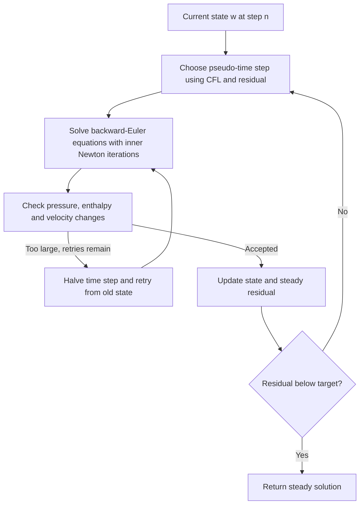

# Steady nozzle example: equations, iteration, settings, and performance

This note describes the code actually called by [steady_nozzle.py](steady_nozzle.py), with the `fast` preset in [settings_steady_lettieri.yaml](settings_steady_lettieri.yaml). It was checked against the source and saved runs on 16 October 2026. The final section assesses performance and identifies work that would improve the solver.

## 1. What the example computes

The example compares two solutions of inviscid, adiabatic, quasi-one-dimensional flow through the Lettieri converging-diverging nozzle:

- A steady reference constructed from isentropic flow relations and a normal-shock jump.
- A finite-volume solution obtained by marching the Euler equations in artificial time until their spatial residual is small.

The current case uses perfect-gas Air, inlet stagnation pressure 200 kPa, inlet stagnation temperature 295.15 K, and a shock halfway along the divergent section. The reference determines the back pressure that supports this shock, approximately 143.855 kPa. The FVM receives this pressure and the geometry; it does not receive the exact profile or the shock location as an initial condition.

The numerical grid has 200 stored positions, including two boundary/ghost positions. Consequently, Newton solves for **198 interior states, or 594 scalar unknowns**. The separate 1,201-position grid resolves the geometry and reference curves more finely; it does not increase the FVM resolution.

The geometry function reads the neighboring Excel file, builds a cubic spline of radius versus axial position, and evaluates the axisymmetric area, $A=\pi r^2$. Although the geometry helper also computes a polynomial fit, the radius used here comes from the spline.

### Source map

| File / function | Responsibility |
| --- | --- |
| [steady_nozzle.py](steady_nozzle.py), `main` | Load inputs, construct geometry and fluid, compute reference, call FVM, save and plot comparisons. |
| [geometry.py](../../nozzle_hyperbolic/fvm_solver/geometry.py), `get_lettieri_nozzle` | Evaluate area and hydraulic diameter from the Excel geometry. |
| [nozzle_exact_real_gas.py](../../nozzle_hyperbolic/fvm_solver/nozzle_exact_real_gas.py) | Construct the steady isentropic branches and normal-shock reference. |
| [fvm.py](../../nozzle_hyperbolic/fvm_solver/fvm.py), `fvm_euler_1d` | Initialize the solution, control pseudo-time steps, test acceptance and convergence, return results. |
| Same file, `make_jax_stadtke_step` | Build the residual, boundary conditions, automatic derivatives, linear solve, and implicit update. |
| Same file, `_jax_F_fvs_stadtke` | Compute the Städtke flux-vector-splitting interface flux. |

The example supplies `jaxprop.FluidPerfectGas`. That model uses constant $R$, $c_p$, and $\gamma$; in this environment $R\approx287.0474$ J/(kg K) and $\gamma\approx1.4016905$. Its constructor obtains constants from a reference state, but subsequent flow-state evaluations use perfect-gas relations. There is no lookup table. Do not assume its $\gamma$ is exactly 1.4 when reproducing the reference independently.

An easily misunderstood implementation detail is `perfect_gas=False` in the solver parameter dictionary. Here this flag selects the **general-EOS FVS Newton implementation**, while the supplied fluid object still defines a perfect-gas EOS. Setting the flag to `True` would select a different solver path. The usual Roe/HLL/HLLC dispatcher in `flux.py` is not called on this FVS path, and changing `space_method` does not change its flux.

## 2. Governing equations

Let $x$ be axial position, $A(x)$ the stationary area, $\rho$ density, $u$ axial velocity, $p$ pressure, and $e$ specific internal energy. Define

$$
E=e+\frac{u^2}{2},\qquad h=e+\frac{p}{\rho},\qquad H=h+\frac{u^2}{2}.
$$

The conservative state and physical flux per unit area are

$$
\mathbf q=\begin{pmatrix}\rho\\\rho u\\\rho E\end{pmatrix},
\qquad
\mathbf f=\begin{pmatrix}\rho u\\\rho u^2+p\\\rho uH\end{pmatrix}.
$$

The code solves

$$
\frac{\partial(A\mathbf q)}{\partial t}
+\frac{\partial(A\mathbf f)}{\partial x}
=\begin{pmatrix}0\\p\,dA/dx-4A\tau_w/D_h\\0\end{pmatrix}.
$$

These are conservation of mass, axial momentum, and total energy. The pressure-area term represents pressure forces on the nozzle walls. The implementation can include a wall shear model through $\tau_w$, but this case sets `wall_friction=False`. No wall heat transfer, viscosity-resolving equations, turbulence model, swirl, or multidimensional boundary layers are solved.

The closure for the present fluid is

$$
p=\rho RT,\qquad h=c_pT,\qquad c_p=\frac{\gamma R}{\gamma-1},
\qquad a^2=\gamma RT.
$$

Although the equations are conservative, the Newton unknowns are the primitive variables

$$
\mathbf w=(p,u,h)^T.
$$

Each residual evaluation converts them to

$$
\mathbf q(\mathbf w)=
\begin{pmatrix}\rho\\\rho u\\\rho(h+u^2/2)-p\end{pmatrix}.
$$

Thus, working in primitive variables does not replace the conservative balances with a nonconservative discretization.

### How the reference solution is obtained

The routine named `nozzle_exact_real_gas` also supports the perfect-gas fluid. It is a steady reference evaluated with numerical root searches, rather than a time-marching solution:

1. Evaluate reservoir enthalpy $h_0$ and entropy $s_0$.
2. On the inlet isentrope, solve $s(h,p)=s_0$ and calculate $u=\sqrt{2(h_0-h)}$ and $G=\rho u$.
3. Locate the maximum $G_*$, giving the choked mass flow $\dot m=A_*G_*$.
4. Solve $G(h)=\dot m/A(x)$ on the subsonic or supersonic branch.
5. At the prescribed shock position, impose

$$
\rho_1u_1=\rho_2u_2,\qquad
p_1+\rho_1u_1^2=p_2+\rho_2u_2^2,\qquad
h_1+u_1^2/2=h_2+u_2^2/2.
$$

6. Continue downstream on the post-shock isentrope and read its exit pressure.

The FVM and reference use the same EOS. Their difference therefore primarily measures discretization and boundary-treatment errors, subject to the finite accuracy of the reference root searches and geometric interpolation.

## 3. Spatial discretization and numerical flux

For uniform spacing $\Delta x$, the cell volume is $V_i=A_i\Delta x$. Face areas are arithmetic averages of neighboring stored areas. The semi-discrete equations are

$$
V_i\frac{d\mathbf q_i}{dt}+\mathbf L_i(\mathbf w)=0,
$$

$$
\mathbf L_i=
A_{i+1/2}\widehat{\mathbf f}_{i+1/2}
-A_{i-1/2}\widehat{\mathbf f}_{i-1/2}
-V_i\mathbf s_i,
\qquad
\mathbf s_i=\begin{pmatrix}0\\(p_i/A_i)(dA/dx)_i\\0\end{pmatrix}
$$

for this frictionless case. The driver replaces the interior geometry derivative by

$$
(dA/dx)_i=\frac{A_{i+1/2}-A_{i-1/2}}{\Delta x}.
$$

This makes the pressure-area source use the same area differences as the flux divergence. It does not make an arbitrary exact smooth flowing solution satisfy the discrete equations identically.

### MUSCL reconstruction

`reconstruction: muscl_van_leer` reconstructs $p,u,h$ componentwise. If $d_-$ and $d_+$ are successive differences, the limited slope is

$$
\sigma_i=
\begin{cases}
2d_-d_+/(d_-+d_+),&d_-d_+>0,\\
0,&\text{otherwise}.
\end{cases}
$$

The face states are $\mathbf w_L=\mathbf w_i+\sigma_i/2$ and $\mathbf w_R=\mathbf w_{i+1}-\sigma_{i+1}/2$. The code adds tiny denominator safeguards and falls back to piecewise constant states when reconstructed pressure or enthalpy lies outside its permitted bounds. These bounds also have fallback values when the fluid has no table.

This is intended to provide second-order spatial reconstruction in smooth regions, with reduced order near shocks and extrema. The FVM captures the shock across a few cells.

### Städtke flux-vector splitting

The active flux evaluates the EOS at the left state, right state, and arithmetic average primitive state. Its wave speeds are

$$
\lambda_1=u+a,\qquad\lambda_2=u-a,\qquad\lambda_3=u.
$$

It constructs characteristic projectors and transforms them into flux space using $\mathbf K=\partial\mathbf f/\partial\mathbf w$. In compact form, away from regularization,

$$
\mathbf P_k=(\mathbf K\mathbf v_k)(\mathbf K^{-T}\mathbf l_k)^T,
\qquad
\widehat{\mathbf f}=
\sum_{\lambda_k\ge0}\mathbf P_k\mathbf f_L
+\sum_{\lambda_k<0}\mathbf P_k\mathbf f_R.
$$

The implementation also scales these projectors using $|\lambda_k|/\lambda_{k,\mathrm{safe}}$. Its sign-change treatment and the `delta_factor` floor modify this scale near zero wave speeds. This describes the implemented formula; the source comments alone do not establish a general entropy-stability or positivity guarantee. The matrix inversions and zero-speed behavior deserve the specific review discussed in Section 7.

`eps_filter: 0.0` disables the optional fourth-order background filter, so it does not contribute to this example's residual.

## 4. What happens during every solver iteration

There are two iteration levels: an **outer pseudo-time step** $n$, and **inner Newton iterations** $k$ that solve that step's implicit equations.



This diagram shows the usual path. Iteration limits, plateau stops, collapsed time steps, and exhausted retries also affect termination, as explained below.

### 4.1 Initialization and compilation

The `simple` initializer builds a pressure distribution between inlet and outlet pressures and estimates velocities from continuity, with a subsonic cap and one density correction. It does not put a shock into the initial state.

The driver constructs JAX-compiled functions, then performs a discarded warmup step to compile them. This is not an accepted flow iteration. The reported `compile_s` includes that first execution as well as compilation.

### 4.2 Choose a pseudo-time step

First calculate a global acoustic CFL limit, excluding ghost cells:

$$
\Delta t_{\mathrm{base}}=
\frac{CFL\,\Delta x}{\max_{\mathrm{interior}}(|u|+a)}.
$$

Switched evolution relaxation, controlled by `ser_beta`, then multiplies it by

$$
\mu_n=\operatorname{clip}\left[
\left(\frac{SSR_1}{SSR_n}\right)^\beta,
1,\frac{CFL_{\max}}{CFL}\right].
$$

The first step uses $\mu=1$. With the fast settings, the base CFL is 20 and the effective cap is 100. As the residual falls, larger pseudo-time steps allow information to propagate through the domain more rapidly. The actual target step can grow by at most 20% relative to the previous step, and the acceptance checks can reduce it further.

These steps are intended to converge a steady solution. They should not be interpreted as an accurate physical time history.

### 4.3 Solve the implicit step by Newton's method

For fixed old state $\mathbf w^n$, the new state must satisfy the backward-Euler residual

$$
\mathbf R_i(\mathbf w)=
V_i[\mathbf q(\mathbf w_i)-\mathbf q_i^n]
+\Delta t\,\mathbf L_i(\mathbf w)=0.
$$

Newton starts from the old interior state. At every inner iteration it evaluates

$$
\mathbf J_k=\frac{\partial\mathbf R}{\partial\mathbf w}(\mathbf w^{(k)}),
\qquad
\mathbf J_k\,\delta\mathbf w_k=-\mathbf R(\mathbf w^{(k)}),
\qquad
\mathbf w^{(k+1)}=\mathbf w^{(k)}+\delta\mathbf w_k.
$$

The update is full and undamped. The current implementation rebuilds the Jacobian at every inner iteration; it does not reuse a frozen Jacobian across Newton iterations.

With `newton_tol: 1.0e-8`, inner iterations stop when the maximum scaled update is small enough, or when `newton_iter: 8` is reached. Pressure uses local $|p|$ as its scale, velocity uses global $\max|u|+1$, and enthalpy uses global $\max|h|$. This is an update-based inner test, distinct from the steady spatial residual. Hitting the eight-iteration cap does not currently produce a separate nonlinear-failure flag.

### 4.4 Reapply boundary conditions inside residual evaluations

Boundary values are functions of the current interior Newton state. They are updated during residual evaluation, not held fixed throughout Newton.

At the inlet, the code extrapolates $u_{\mathrm{in}}=2u_1-u_2$, sets $h_{\mathrm{in}}=h_0-u_{\mathrm{in}}^2/2$, and makes three pressure Newton updates to enforce $s(h_{\mathrm{in}},p)=s_0$:

$$
p\leftarrow p+\rho T[s(h_{\mathrm{in}},p)-s_0].
$$

At the outlet, it obtains velocity from area-weighted density/momentum extrapolation and extrapolates enthalpy. Pressure blends between imposed back pressure for subsonic flow and extrapolated pressure for supersonic flow, using a smooth transition around Mach 1 of width 0.004. The auxiliary extrapolated density used for velocity is not independently enforced as the EOS density of the final ghost state.

### 4.5 Accept or retry the candidate step

The driver tests maximum changes over the stored states:

$$
\max\frac{|\Delta p|}{p}<0.20,\qquad
\max\frac{|\Delta h|}{|h|}<0.10,\qquad
\max\frac{|\Delta u|}{|u|+a}<0.20.
$$

Small denominator safeguards are omitted here for readability. If these checks fail, it halves $\Delta t$ and reruns Newton from the original old state.

**After the maximum eight halvings, the current driver accepts the candidate anyway**, and inflates the reported residual to at least ten times the convergence target. The limiter therefore is not a guarantee of nonlinear convergence or positivity. Improving this failure path is a higher priority than merely raising the CFL cap.

### 4.6 Evaluate steady convergence and advance

After an accepted update, the code evaluates the spatial residual with the time-change term removed. The actual convergence measure is

$$
SSR=\sqrt{\operatorname{mean}_{i,j}
\left[\frac{t_c\,L_{i,j}}
{V_i|q_{i,j}|+10^{-300}}\right]^2},
\qquad
t_c=\frac{\Delta x}{\max(|u|+a)}.
$$

It is an RMS nondimensional conservation residual, not the change between consecutive states. Consequently, taking tiny pseudo-time steps does not by itself establish convergence. Some older function docstrings describe a state-change metric; the executable residual calculation is the authority here.

The driver updates the solution, cumulative pseudo-time, iteration counter, and last-five-residual history. It stops when the residual is below the target. It also permits a plateau stop after 50 iterations if the last five values have max/min below 1.5 and the residual is below three times the target. Iteration limits and a collapsed time step can stop it too.

The example explicitly checks `SSR < residuals`, so a plateau above the requested tolerance is saved and reported as **unconverged**. Conservation is also checked using the numerical face mass flux. Cell-center $\rho uA$ is useful for visualization but is not the discretely conserved face flux at a captured shock.

## 5. Defaults, original validation settings, and the faster example

Three different things should not be conflated: source-code fallback defaults, the original validation YAML, and this example's presets. The original validation YAML **already enabled the optimized banded/Jacobian kernels** before this example was written.

### Actual changes from the original validation case

| Setting | Original validation YAML | Current example, `fast` | Reason / consequence |
| --- | --- | --- | --- |
| Number of shock cases | 3: 25%, 50%, 75% | 1: 50% | Avoid repeated complete validation runs. |
| Fluid | Air bicubic lookup table | `FluidPerfectGas` | Avoid invalid table points and table generation; changes the physical EOS approximation. |
| Stored grid positions | 300 | 200 | Less work, with a coarser spatial approximation; this is not an equal-accuracy speedup. |
| Base `CFL` | 0.5 | 20 | Larger initial pseudo-time steps; still subject to adaptive checks. |
| `ser_cfl_max` | 50 | 100 | Larger steps near convergence; tested for this case, not a universal optimum. |
| `ser_beta` | 1 | 1 | Retained the existing residual-based CFL ramp. |
| Steady `residuals` | $10^{-8}$ | $10^{-9}$ | A stricter algebraic stopping target, not a shortcut. |
| Maximum iterations | 20,000 | 10,000 | A failure/runaway cap; does not accelerate a run that converges earlier. |
| End time | 100 s | Infinite pseudo-time limit | Stop on steady convergence or iteration cap. |
| Initialization / reconstruction | `simple` / MUSCL van Leer | Same | No exact-profile seeding or reduced-order flux. |
| Newton cap / tolerance | 8 / $10^{-8}$ | Same | Retained early inner stopping. |
| Banded solver and local Jacobians | Enabled | Enabled | Carried over existing optimizations. |
| Friction / extra filter | Off / off | Same | Match the inviscid reference. |

The original YAML has since also been switched to perfect gas during this session. The table above records its original lookup-table configuration, as stored in Git HEAD, rather than attributing that earlier switch to a later performance experiment.

### What the optimized switches do

| Control | Fallback when omitted from the FVM driver | Current fast setting | Effect |
| --- | --- | --- | --- |
| `linear_solver` | `dense` | `banded` | Avoid dense matrix assembly/factorization; retain the local stencil. |
| `jacobian` | `dense` | `colored` | Compute derivatives using a fixed number of independent directional probes. |
| `newton_iter` | 20 | 8 | Limit work per implicit step; insufficient iterations can reduce robustness. |
| `newton_tol` | 0: fixed iteration count | $10^{-8}$ | Stop inner Newton when its scaled update is small. |
| `flux_local_jac` | `false` | `true` | Reuse each face's small derivative within a Jacobian evaluation. |
| `cell_local_jac` | `false` | `true` | Do the same for the cell thermodynamic outputs. |
| `fast_increments` | `false` | `true` | Fuse the acceptance checks into a JIT-compiled function. |
| `ser_beta` | 0: no ramp | 1 | Increase pseudo-time CFL as the steady residual falls. |
| `adaptive_dt` | `true` | `true` | Retain step-growth limits and large-update retries. |

For completeness, the driver fallback reconstruction is piecewise constant and its fallback `delta_factor` is 0.1. This case deliberately retains MUSCL and $10^{-6}$, respectively. The helper factory has some different direct-call defaults; the driver defaults are the relevant ones for this script.

For MUSCL, a residual row depends on cells $i-2$ through $i+2$. The Jacobian is therefore block pentadiagonal with $3\times3$ blocks. Fifteen colored tangent directions recover its nonzero entries independently of grid length. The banded solver groups two cells into $6\times6$ superblocks and applies block Thomas forward/backward sweeps using `lax.scan`. For a fixed stencil, storage and solve work scale linearly with $N$, rather than dense factorization's cubic scaling. Pivoting is local to the superblocks.

The local-Jacobian switches compute face $3\times6$ and cell $3\times3$ derivatives and reuse them across colored directions at the **same Newton state**. They do not freeze derivatives across iterations.

The banded path always uses colored compression internally. If a new nonlocal coupling invalidates the stencil, setting only `jacobian: dense` is insufficient: use **both** `linear_solver: dense` and `jacobian: dense` for a true dense fallback. `jacobian_validate` can compare the two Jacobians during development.

The YAML's `baseline` preset is a deliberately slower comparison configuration, with dense factorization, fixed-count Newton and no SER/local-Jacobian acceleration. It still shares this example's mesh, MUSCL reconstruction, colored Jacobian setting, and eight-iteration cap. It is neither the literal source fallback configuration nor the already-optimized original validation YAML.

## 6. What has actually been measured

The saved [fast-run summary](results_steady/fast/summary.json) records:

| Quantity | Measured value |
| --- | --- |
| Interior unknowns | 594 |
| Accepted pseudo-time iterations | 215 |
| Marching time, `wall_s` | 1.499 s |
| Average per accepted iteration, including retries | 6.97 ms |
| Warmup/compilation, `compile_s` | 2.259 s |
| Setup through reference construction, `setup_s` | 1.357 s |
| Total measured inside `main()` | 6.440 s |
| Final spatial residual | $7.98\times10^{-10}$ |
| Mean $|\Delta p|/p_0$, away from shock | $2.903\times10^{-4}$, or 0.0290% |
| Mean $|\Delta\rho|/\rho_0$, away from shock | $2.554\times10^{-4}$ |
| Mean absolute Mach error, away from shock | $5.737\times10^{-4}$ |
| Shock-position error | Approximately -0.34 grid cells |

These are local single-run observations, not a statistical benchmark. The environment uses Python 3.13.2, JAX/jaxlib 0.6.2, NumPy 2.3.5, CPU execution, and 64-bit arithmetic. The existing saved timings do not record CPU model or affinity.

`wall_s` excludes setup, the initial compilation warmup, plotting and final diagnostics. Some small functions first compile during the march, so even this split is not perfectly pure. `total_s` starts after module imports and stops before the blocking figure window: it is **not** total process startup latency. The three named timing components do not exhaust `total_s`; initialization, diagnostics, conversion, saving and plotting account for additional work.

An earlier run with the same fast settings reported about 6.6 ms per accepted iteration in the Newton step and 0.3 ms in acceptance checks. Those coarse timers put most marching time inside Newton stepping, but do not separate residual evaluation, automatic differentiation, linear factorization and triangular solves.

The matched `no_ser` preset took 356 iterations and 1.960 s, but stopped on the plateau rule at $2.96\times10^{-9}$ and was correctly flagged unconverged. It therefore does not establish a converged-to-converged speedup ratio. No full dense-baseline result for this exact case was measured. Large historical speedups in [the existing performance report](../../dev_scripts/SPEEDUP_REPORT_FVS_SINGLE_PHASE.md) involve other configurations and must not be presented as measurements of this example.

A small parameter sweep tested higher initial CFLs and caps; CFL 20 with cap 100 had the lowest measured marching time among the locally tested configurations. Another trial had a slightly lower total script time. These single-run comparisons do not establish a global optimum or guarantee robustness for other geometries/EOSs.

## 7. Is this solver competitive, and what should be revised?

### Assessment

**It is fast enough for interactive single-case research and verification. It has not yet demonstrated competitive performance against a dedicated modern steady quasi-1D solver.** A 1.5-second march is convenient, and the banded algorithm has an appropriate complexity for this problem. However, 594 unknowns is a small system, and compilation plus validation work costs more than the march itself. Comparing this runtime with a multidimensional CFD run would not be a meaningful performance test.

For a few nozzle designs, the present speed is likely adequate. For optimization, uncertainty analysis, or coupling to a larger system, repeated-solve latency and reliability matter much more. At the measured rate, 10,000 fresh solves would cost roughly four hours of marching alone, before compilation, reference generation or failed cases; this is a workload estimate, not a measured sweep.

For the very narrow class of steady, inviscid, perfect-gas nozzles with a simple normal shock, a dedicated area-Mach/shock root solver avoids evolving hundreds of flow unknowns. It is a more economical formulation when only that steady answer is required. The present general-EOS FVM earns its extra cost when the intended application needs broader thermodynamics, source terms, transient capability or future coupled models. The performance comparison should use those requirements, rather than treating all nozzle models as interchangeable.

The priorities below distinguish demonstrated limitations from proposed optimizations. **No implementation changes in this list have been made by writing this note.**

### Priority 1: fix failure handling and audit the characteristic flux

Before pursuing larger CFLs, return the inner Newton convergence status, reject non-finite states, and reject a failed implicit solve after exhausted retries. Add damping or another globalization strategy where full Newton updates are unreliable. The present accept-after-eight-halvings behavior is an implementation limitation, not an unavoidable property of FVM.

There is also a concrete issue in the flux algebra. It solves systems involving $\mathbf K^T$, where $\mathbf K=\partial\mathbf f/\partial\mathbf w$. Its determinant contains the Euler characteristic factor $u(u^2-a^2)$, so this transformation becomes singular at rest and at sonic states. The eigenvalue floor does not regularize this matrix solve.

A direct equal-state check was performed during this review using the current perfect-gas model, $p=100$ kPa, $T=250$ K, and `delta_factor=1e-6`. It compared $\widehat{\mathbf f}(\mathbf w,\mathbf w)$ with the physical flux. The **zero-velocity state returned non-finite fluxes**. Mach 0.03, 0.5 and 1.75 agreed to roundoff; the tested Mach-1 state happened to remain finite, while states within $10^{-8}$ of Mach 1 showed scaled component differences around $3.5\times10^{-9}$. This demonstrates the rest-state defect; it does not show that every sonic evaluation fails.

Review the projector formulation and its regularization against equal-state consistency, stationary contacts, sonic expansion and positivity tests. Do not equate the source's entropy-fix comments with a proof of entropy stability. A formulation avoiding the singular flux-Jacobian inverse could improve reliability and may also remove expensive small linear solves.

### Priority 2: measure and reduce work inside Newton

The measured large cost is Newton stepping. Record the number of inner iterations, rejected attempts, residual evaluations, Jacobian evaluations and factorizations. Use a compiled profiler to identify which kernels dominate; the current timers cannot answer that question. [JAX's profiling guide](https://docs.jax.dev/en/latest/profiling.html) describes the relevant tools.

Today every inner Newton iteration rebuilds and refactors the Jacobian. For a steady target, it is worth comparing this with a frozen/inexact Jacobian strategy, one or a few linearly implicit pseudo-time updates, or a switch to a globalized direct steady Newton solve after startup. Schematically, linearly implicit continuation solves

$$
\left[\frac{V\,\partial\mathbf q/\partial\mathbf w}{\Delta t}
+\frac{\partial\mathbf L}{\partial\mathbf w}\right]\delta\mathbf w
=-\mathbf L(\mathbf w).
$$

That need not fully converge a backward-Euler nonlinear subproblem at every outer step. PETSc's [TSPSEUDO](https://petsc.org/main/manualpages/TS/TSPSEUDO.html) is an established example of linearly implicit pseudo-transient continuation for steady problems. These are candidate methods, not measured speedups for this solver; shock limiters and changing wave directions still require globalization and validation.

Warm-starting neighboring operating points or using a coarse-grid solution is another natural option for sweeps. It should be benchmarked independently from the current validation, which intentionally starts without the exact profile.

### Priority 3: reuse compilation across cases

The factory creates new compiled closures on each solver invocation and captures geometry, boundary data and settings in them. Repeating `fvm_euler_1d` with a different operating point is therefore not guaranteed to reuse a previously compiled executable. At 2.26 s, the first warmup already costs more than the measured march.

Separate reusable compiled kernels from changing runtime arrays and scalar parameters. Reuse kernels for fixed mesh shapes, and consider an explicit persistent compilation cache; the current short example does not configure one. JAX supports a [persistent disk cache](https://docs.jax.dev/en/latest/persistent_compilation_cache.html), but changing captured constants can still change the compiled program and prevent reuse. Measure fresh-process latency and repeated solves in one process separately.

### Priority 4: simplify expensive face calculations where appropriate

The generic FVS flux evaluates three thermodynamic face states, constructs characteristic transformations, and performs three small projection solves per face. Automatic differentiation must also handle this algebra. This is more work than a simple perfect-gas flux needs in principle.

After profiling, compare an algebraically simplified projection or a dedicated perfect-gas formulation. Roe, HLLC or another simpler flux is also a possible comparison, but it would require wiring a different solver path and would change the discrete scheme. Match spatial accuracy, shock behavior and convergence quality before claiming a gain. Editing `space_method` in the present YAML would not perform this experiment.

Do not assume every unused-looking EOS/transport operation in the Python source consumes runtime: XLA can remove computations when `wall_friction=False` and `eps_filter=0`. Inspect the compiled profile before rewriting those parts.

### Priority 5: reduce host control overhead after profiling it

The outer controller is a Python loop. It repeatedly retrieves scalar CFL/residual information, waits for Newton results, and retrieves acceptance checks. Compiling the adaptive controller and retry loop, or executing small compiled batches between reports, could reduce synchronization overhead. JAX's [asynchronous-dispatch documentation](https://docs.jax.dev/en/latest/async_dispatch.html) explains why host reads force synchronization; [`lax.while_loop`](https://docs.jax.dev/en/latest/_autosummary/jax.lax.while_loop.html) provides a compiled loop primitive.

However, the existing breakdown does **not** show Python control to be the dominant cost. Preserve the acceptance logic and convergence diagnostics; do not remove them simply to make a timing smaller. Similarly, a GPU is not automatically useful for one 200-position problem with small sequential banded solves. Batching many independent cases would be the more relevant accelerator experiment.

### Priority 6: streamline validation overhead and improve performance evidence

The example computes the general-EOS reference twice, repeating reservoir/choking/shock preparation for the fine and FVM grids. The reference uses nested isentrope root searches, sonic searches, and a scalar shock scan even for a perfect gas. Share that preparation between grids or use direct perfect-gas relations if validation latency matters. Read and fit the Excel geometry once. Skip reference generation and plotting entirely in a production sweep when they are not needed. These changes reduce end-to-end example time, rather than the FVM marching time.

The legacy allocation of 1,000 conservative history slices before entering the FVS branch is unnecessary for a steady-only return, but is only about 4.8 MB at this mesh size. Cleaning it up is reasonable; there is no evidence that it is a major bottleneck.

For a defensible competitiveness claim, benchmark on recorded hardware with fixed thread settings, warmup and synchronized timings, repeated samples, and the same EOS, mesh and required error. Include cold startup, compilation, warm solve, residual target, conservation errors and failures. JAX's [benchmarking guide](https://docs.jax.dev/en/latest/benchmarking.html) specifically distinguishes compilation, asynchronous execution and precision when making comparisons.

Use mesh refinement to compare **time to a required solution accuracy**, rather than rewarding a coarser grid. The algebraic tolerance is already far below the current spatial error; driving the residual much lower without refining the mesh will not proportionally improve the physical answer. Track componentwise and maximum residuals as well as the global RMS, especially near zero momentum where its local normalization becomes delicate. If the optional background filter is later enabled, also include it in the reported face-flux conservation diagnostic; the current diagnostic omits that contribution.

The most useful next development step is therefore to make failure states explicit and instrument the Newton kernel, then establish a reusable steady-solve benchmark. The existing banded solve is the right foundation. Reliable globalization, fewer Jacobian/factorization evaluations, and compilation reuse are stronger priorities than indiscriminately increasing CFL or adding hardware parallelism.

## 8. Should the boundary equations join the global Newton solve?

**Yes, this is a valid formulation and a worthwhile general-EOS experiment. For the current perfect-gas case, however, removing the inlet root solve algebraically is the simpler first improvement.** The existing Jacobian already includes the boundary dependence on the interior state. Promoting boundary values to unknowns would change how that dependence is evaluated, rather than introduce a coupling that is currently missing.

This section analyzes the proposal and provides an implementation prompt. It does not implement either alternative or claim a measured speedup.

### 8.1 What is actually nested today?

In `_bc_inlet`, the code first calculates

$$
u_b=2u_1-u_2,\qquad h_b=h_0-u_b^2/2,
$$

subject to its enthalpy bounds. It then takes three pressure Newton updates for

$$
B(p_b,h_b)=s(h_b,p_b)-s_0=0.
$$

That small pressure solve occurs inside the interior residual, which is itself evaluated and differentiated inside the global Newton iteration. There is therefore nested computational work at the inlet.

The active outlet treatment does **not** have an inner root solve. It uses two interior EOS evaluations, extrapolation and a smooth Mach-dependent pressure blend. The older outlet bisection appears only in commented code. Adding outlet unknowns would simplify the uniform block layout, but would not remove an active outlet iteration loop.

Importantly, the inlet and outlet are recomputed from the **current** interior Newton guess. `jax.linearize` / `jax.jacobian` differentiates these computations, including the three inlet pressure updates. This is not a staggered algorithm that holds boundary values fixed while ignoring their effect on the Jacobian.

### 8.2 Eliminated and coupled formulations are mathematically related

Write $\mathbf x$ for all interior unknowns, $\mathbf b$ for boundary unknowns, $\mathbf F(\mathbf x,\mathbf b)=0$ for the interior implicit-step residual, and $\mathbf B(\mathbf x,\mathbf b)=0$ for the boundary equations.

If the boundary equations are solved exactly as $\mathbf b=\mathbf g(\mathbf x)$, the current style solves a reduced system:

$$
\widetilde{\mathbf F}(\mathbf x)=\mathbf F(\mathbf x,\mathbf g(\mathbf x))=0.
$$

Implicit differentiation gives

$$
\frac{d\mathbf g}{d\mathbf x}=-\mathbf B_b^{-1}\mathbf B_x,
\qquad
\widetilde{\mathbf J}=\mathbf F_x-\mathbf F_b\mathbf B_b^{-1}\mathbf B_x.
$$

Your proposed coupled formulation would instead solve

$$
\begin{pmatrix}\mathbf F_x&\mathbf F_b\\\mathbf B_x&\mathbf B_b\end{pmatrix}
\begin{pmatrix}\delta\mathbf x\\\delta\mathbf b\end{pmatrix}
=-\begin{pmatrix}\mathbf F\\\mathbf B\end{pmatrix}.
$$

At a boundary-consistent state, $\mathbf B=0$, eliminating $\delta\mathbf b$ gives the same reduced interior Newton equation. Thus an exact eliminated formulation and a coupled formulation contain the same local coupling. They need not take identical nonlinear iteration paths: elimination puts the boundary back on its constraint surface after every evaluation, while a simultaneous Newton update generally satisfies the nonlinear constraint only approximately until convergence.

There is an additional qualification in this code: three inlet pressure updates define an approximate map $\mathbf g_3$, not a root solve with an explicit convergence check. AD differentiates $\mathbf g_3$, including its pressure seed and clips. Its derivative is not automatically the exact implicit derivative above. Exact equivalence requires a sufficiently converged boundary root and consistent treatment of any active bounds.

### 8.3 First choice for this example: use the existing algebraic perfect-gas inversion

For constant $c_p$ and $\gamma$, the inlet condition has the explicit solution

$$
T_b=\frac{h_b}{c_p},\qquad
p_b=p_0\left(\frac{T_b}{T_0}\right)^{\gamma/(\gamma-1)}.
$$

With the existing velocity extrapolation and valid, unclipped reservoir relation, $T_b=T_0-u_b^2/(2c_p)$. No pressure iteration is necessary.

The installed `FluidPerfectGas` already exposes this inversion through its public interface:

```python
inlet_state = fluid.get_state(jxp.HmassSmass_INPUTS, h_b, s0)
p_b = inlet_state["p"]
```

Its `calculate_properties_hs` implementation computes pressure algebraically. A perfect-gas-specific branch in the nozzle solver could use this existing API while retaining the relevant admissibility bounds. It would require **no changes to `jaxprop`**, no extra global unknowns, and no change to the banded stencil. This recommendation applies to `FluidPerfectGas`; the same input pair for a general EOS may itself invoke an iterative inversion.

As a numerical check during this analysis, this public API was evaluated at inlet velocities 0, 100, 200 and 300 m/s for the current reservoir. It returned the corresponding pressures and its AD derivative agreed to roundoff with

$$
\frac{dp_b}{du_b}=-\rho_bu_b.
$$

This is a functional/derivative check, not a performance measurement. It makes the algebraic path a low-complexity experiment before changing the global system.

### 8.4 Another general-EOS option: implicit differentiation of the boundary root

For an adequately converged inlet root, thermodynamic identities give

$$
\left(\frac{\partial s}{\partial h}\right)_p=\frac1T,
\qquad
\left(\frac{\partial s}{\partial p}\right)_h=-\frac1{\rho T},
\qquad
\left(\frac{dp_b}{dh_b}\right)_{s_0}=\rho_b.
$$

With the unclipped energy relation, $dp_b/du_b=-\rho_bu_b$. The pressure root can therefore be evaluated numerically while its derivative is supplied through implicit differentiation, avoiding AD through every root iteration. JAX provides [`lax.custom_root`](https://docs.jax.dev/en/latest/_autosummary/jax.lax.custom_root.html) for this pattern, or a carefully validated custom JVP could encode the scalar relation.

This still performs the primal root solve. It reduces derivative work rather than removing the nested evaluation altogether. It also requires root-convergence diagnostics and explicit handling of active bounds: applying the exact implicit derivative to an unconverged or clipped three-step map would be inconsistent. Simply inserting `stop_gradient` would discard real boundary coupling and is not the proposed solution.

For a lookup-table EOS, check thermodynamic consistency before hardcoding $dp_b/dh_b=\rho_b$. Independently interpolated entropy and density need not satisfy the identities exactly. The derivative of the **implemented** root equation is

$$
\frac{dp_b}{dh_b}=-\frac{\partial s(h_b,p_b)/\partial h_b}
{\partial s(h_b,p_b)/\partial p_b}.
$$

Use derivatives of the actual entropy implementation, or verify their agreement with the thermodynamic identity. This qualification does not affect the checked perfect-gas result.

### 8.5 How to formulate a simultaneous boundary/interior Newton solve

If a coupled experiment is implemented, retain all three primitive variables in each boundary cell:

$$
\mathbf z=(\mathbf w_0,\mathbf w_1,\ldots,\mathbf w_{N-1}).
$$

At $N=200$, this increases the unknown count from 594 to **600**, only about 1%. Adding just the inlet pressure would add fewer unknowns, but would require a special scalar border or irregular blocks in the present three-variables-per-cell linear solver. Full boundary blocks are a cleaner first prototype.

For the positive-flow subsonic inlet used here, the three boundary equations can be written as

$$
\mathbf B_{\mathrm{in}}=
\begin{pmatrix}
[u_0-(2u_1-u_2)]/u_{\mathrm{ref}}\\
[h_0^{\mathrm{ghost}}+u_0^2/2-h_{\mathrm{stag}}]/h_{\mathrm{ref}}\\
[s(h_0^{\mathrm{ghost}},p_0^{\mathrm{ghost}})-s_{\mathrm{stag}}]/s_{\mathrm{ref}}
\end{pmatrix}=0.
$$

Here $h_0^{\mathrm{ghost}}$ denotes the ghost-cell static enthalpy, not the reservoir enthalpy; reservoir quantities are explicitly labeled `stag` to avoid that ambiguity. The three scales should be fixed physical reference magnitudes, such as stagnation sound speed, positive enthalpy scale, and $R$ for a gas entropy scale.

These equations describe the intended inlet physics inside the valid EOS range. Exact equivalence to the existing clipping behavior needs a deliberate decision when bounds activate. Prefer damped admissible updates and explicit failure reporting over silently changing the target reservoir condition through independent clipping.

For the outlet, let $\boldsymbol\beta_{\mathrm{out}}(\mathbf w_{N-2},\mathbf w_{N-3})$ be the existing algebraic boundary map, including its geometry factors, Mach blend and bounds. Use scaled equations

$$
\mathbf B_{\mathrm{out}}=
\mathbf D_{\mathrm{out}}^{-1}
[\mathbf w_{N-1}-\boldsymbol\beta_{\mathrm{out}}]=0.
$$

This preserves the current outlet treatment. Imposing an additional EOS-density extrapolation constraint would change that treatment and should be a separate experiment.

The combined residual contains three inlet equations, the unchanged conservative backward-Euler equations for the interior cells, and three outlet equations. **Boundary rows are algebraic constraints with no pseudo-time accumulation or artificial ghost-cell conservation equations.** Residual row scaling matters because entropy, pressure, velocity, enthalpy and integrated conservation residuals have different units. Monitor dimensionless boundary constraint errors separately from the interior spatial SSR.

The implementation must then:

1. Update Newton vector sizes, reshaping, coloring, block extraction, padding and linear-solver indexing to include both boundary blocks.
2. Evaluate fluxes directly from the trial boundary unknowns. Do not overwrite them by calling the old inlet root solver inside the coupled residual, post-update reconstruction, SSR evaluation or face-flux diagnostics.
3. Keep the boundary equations in the Newton residual and Jacobian, including their dependence on the nearest two interior cells.
4. Update convergence/acceptance logic so both the interior SSR and boundary constraints must converge; a small interior SSR alone is insufficient.
5. Add damping/admissibility checks and explicit inner-solve failure reporting. A boundary variable must not wander into invalid EOS states during a trial update.

For current MUSCL reconstruction, the augmented Jacobian remains within a two-cell half-bandwidth, so 15 colors and $6\times6$ superblocks remain plausible. They still need verification against the dense augmented Jacobian. **For piecewise-constant reconstruction, the bandwidth must increase from one to two**, because the inlet constraint row reads interior cells 1 and 2; the present nine-color assumption would no longer suffice. The factorization can remain $O(N)$, but the constant-reconstruction variant may incur more work.

### 8.6 Would this make the present run faster?

It could, but the available timings do not isolate boundary work. Removing three scalar pressure iterations does not remove the face fluxes, their derivatives, or the global banded factorization. Boundary work is localized, while the number of faces grows with the mesh. A simultaneous formulation also adds constraint evaluations and allows temporary boundary errors, which can alter Newton iteration counts and retries.

Holding all other work and iteration counts fixed, if a fraction $f$ of marching time were attributable to removable boundary work, eliminating all of that work would have the optimistic bound $S=1/(1-f)$. For example, a hypothetical 5% share permits at most about a 5.3% gain before accounting for replacement work. **That percentage is illustrative; $f$ has not been measured here.** Boundary inversions could matter more for an expensive real-fluid EOS or a larger network of components.

The recommendation is therefore:

- **Current perfect-gas case:** test algebraic eliminated inlet pressure first.
- **General EOS with an expensive boundary inversion:** compare implicit differentiation and an optional simultaneous formulation.
- **Default production choice:** select by matched-error measurements of total warm solve time, convergence and failures, rather than assume the larger coupled system is faster.

### 8.7 Suggested implementation prompt

The following prompt describes a controlled implementation without changing the physical problem or `jaxprop` source:

```text
Investigate boundary-equation handling in the Städtke FVS Newton path in
nozzle_hyperbolic/fvm_solver/fvm.py, using case_study/cases_roberto/
steady_nozzle.py and settings_steady_lettieri.yaml as the benchmark.

Keep the existing behavior available as a reference. Do not modify jaxprop,
the interior conservative flux/source discretization, the nozzle geometry,
or the outlet boundary physics. Keep 64-bit arithmetic and the banded solve.

Stage 1: instrument and simplify the perfect-gas inlet.
- Record residual/Jacobian evaluations, Newton iterations, factorizations,
  retries, and boundary residual errors in addition to existing timings.
- Add an optional inlet-pressure method that uses FluidPerfectGas's existing
  get_state(HmassSmass_INPUTS, h_boundary, s_stagnation) algebraic inversion.
  Retain the current three-update method for comparison. Do not assume that
  this API is algebraic for every fluid class.
- Validate pressure and boundary derivatives, including dp/dh=rho and
  dp/du=-rho*u in the admissible, unclipped regime. Define how active bounds
  and invalid trial states are handled; do not silently discard derivatives.
- If adding implicit differentiation for a general-EOS pressure root, use
  -s_h/s_p from the actual entropy implementation, or verify its agreement
  with rho. Do not assume a lookup interpolant is thermodynamically exact.

Stage 2: implement an experimental coupled boundary formulation.
- Add boundary_formulation: eliminated | coupled, defaulting to eliminated.
- In coupled mode include all three primitive variables in each ghost cell:
  3*N unknowns, rather than 3*(N-2).
- Replace inlet ghost rows with scaled velocity-extrapolation, reservoir
  total-enthalpy, and entropy constraints. Replace outlet ghost rows with
  scaled unknown-minus-existing-algebraic-outlet-map constraints.
- Keep pseudo-time terms only in interior conservation rows. Do not call
  a nested pressure root solver or overwrite boundary unknowns in this mode.
- Update all residual/unknown dimensions, reconstruction, banded block
  extraction/padding, Newton scales, post-update output, SSR and diagnostics.
- Derive sparsity explicitly. Retain half-bandwidth two for MUSCL and widen
  constant-reconstruction cases to at least two due to boundary constraints.
  Compare the augmented colored Jacobian and linear Newton direction with
  dense AD on a small mesh. Avoid an accidental dense production fallback.
- Require both interior SSR and boundary constraints to meet tolerance.
  Report/reject failed or non-finite Newton candidates; add admissible damping
  rather than accepting a failed solve after exhausted retries.

Validation and decision:
- At a boundary-consistent valid state, check the augmented system's Schur
  complement against the reduced system with a converged boundary inversion.
  Do not expect identical nonlinear trajectories or exact agreement with an
  unconverged three-update map.
- Compare legacy eliminated, algebraic perfect-gas, and coupled treatments
  on identical meshes, initial conditions, CFL schedules and error targets.
  Include constant and MUSCL reconstruction checks and admissibility failures.
- Compare boundary constraint errors, conservation, shock position and
  pressure/Mach profiles; include an appropriate general-EOS case for any
  claim of benefits to real-fluid modeling.
- Report repeated cold compilation and warm solve timings separately, with
  Newton/retry/evaluation counts. Do not count a plateau above tolerance as
  a converged result or claim speedups from fewer grid points.
- Keep the simplest formulation that provides a measured benefit without
  sacrificing accuracy or robustness. Document negative performance results
  as well as improvements; no speedup is assumed in advance.
```
